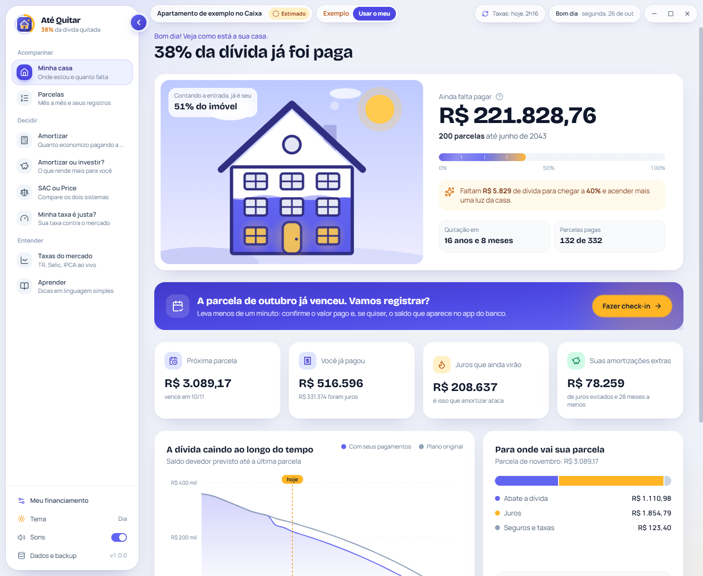
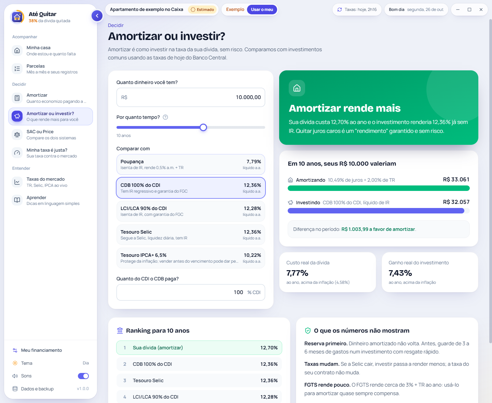
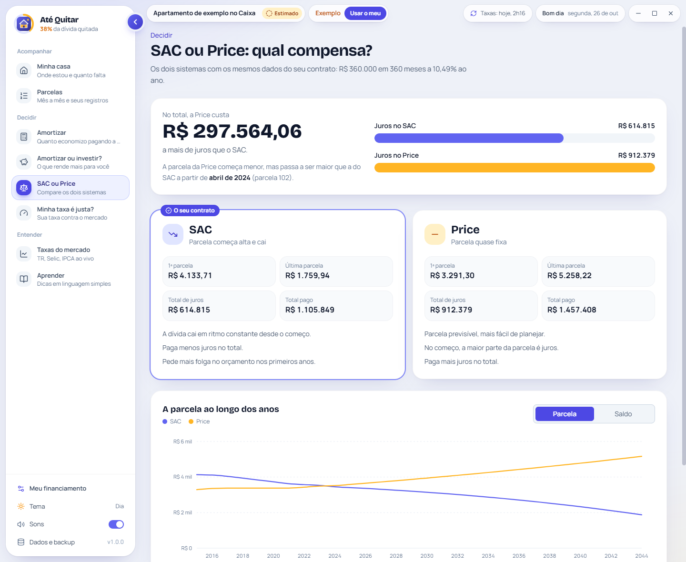
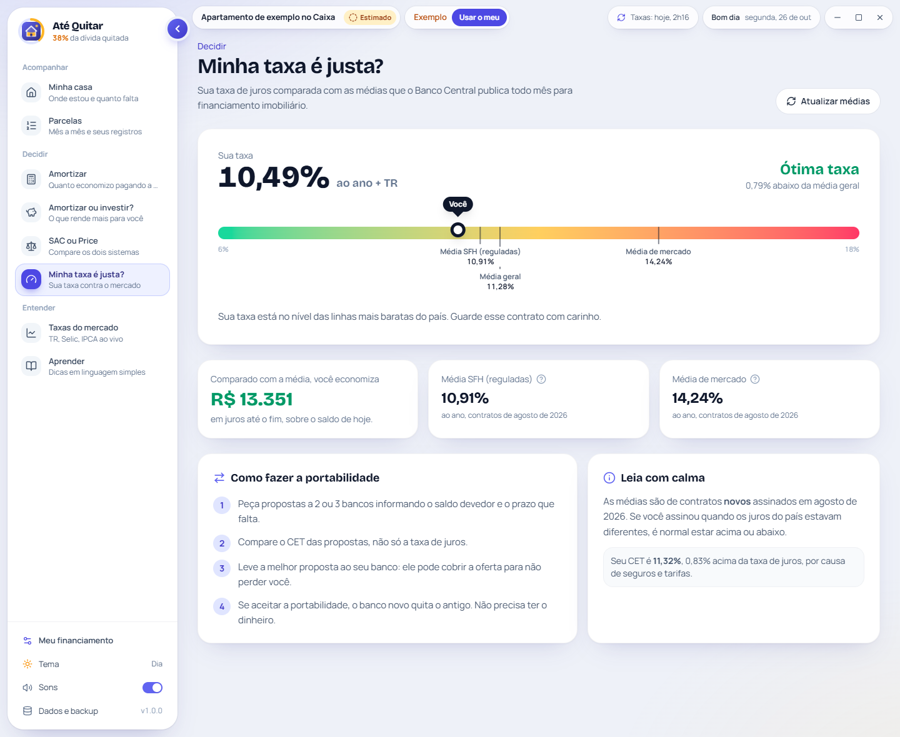
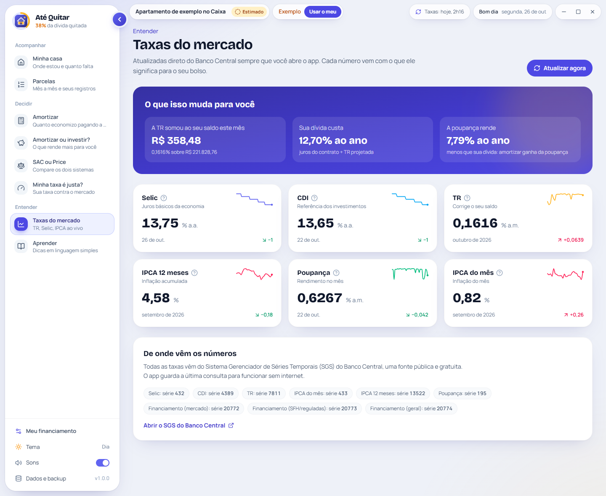
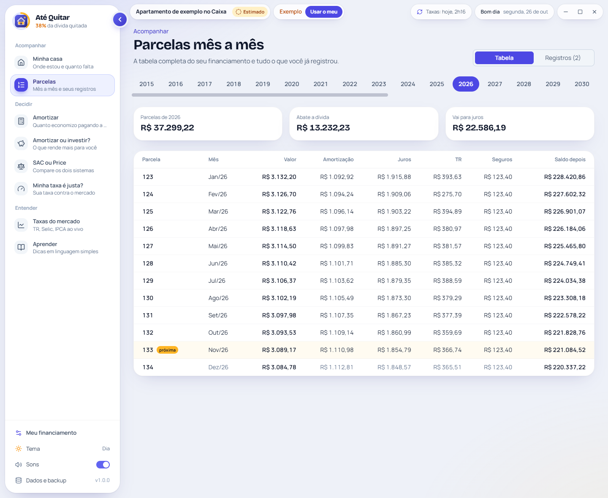

<div align="center">


<br />

**Acompanhe o financiamento da sua casa até a última parcela.**<br />
Quanto já é seu, quanto falta, se vale amortizar ou investir e se a sua taxa é justa, com as taxas do Banco Central sempre em dia.

<br />

[](https://github.com/leandrotsampa/AteQuitar/releases/latest)
[](https://github.com/leandrotsampa/AteQuitar/releases)
[](https://github.com/leandrotsampa/AteQuitar)
[](LICENSE)
<br />


[**Baixar para Windows, macOS ou Linux**](https://github.com/leandrotsampa/AteQuitar/releases/latest) ·
[Veja em ação](#-veja-em-ação) ·
[Funcionalidades](#-funcionalidades) ·
[Telas](#-telas) ·
[Como o cálculo funciona](#-como-o-cálculo-funciona) ·
[Desenvolvimento](#%EF%B8%8F-desenvolvimento)

</div>

---

## 🎬 Veja em ação

<div align="center">


<sub>A casa enchendo, o check-in do mês, o simulador de amortização, amortizar ou investir e o tema escuro, no financiamento de exemplo do app.</sub>

</div>

## 💡 Por que existe

Quem financia a casa recebe um boleto por mês e um extrato por ano, e quase nunca entende o que está acontecendo: por que o saldo cai tão devagar, quanto da parcela é juros, se compensa usar o FGTS ou o 13º para amortizar, se é melhor reduzir o prazo ou a parcela, se o dinheiro rende mais aplicado do que abatendo a dívida, se a taxa do contrato está alta em relação ao mercado.

O **Até Quitar** responde essas perguntas com os números do seu contrato. Você cadastra o financiamento uma vez, com ajuda em cada campo dizendo **onde achar a informação** no contrato, no boleto ou no app do banco, e faz um **check-in** rápido todo mês. A TR, a Selic, o CDI, o IPCA, a poupança e as taxas médias de financiamento vêm direto do **Banco Central** e se atualizam sozinhas.

> Pensado para pessoas comuns: sem economês, com explicações curtas, animações que mostram a casa sendo conquistada e conquistas a cada 10% da dívida quitada.

## ✨ Funcionalidades

<table>
<tr>
<td width="50%" valign="top">

### 🏠 Minha casa
- **A casa que se enche:** a ilustração vai sendo preenchida conforme a dívida cai, e **uma luz acende a cada 10%**. De dia no tema claro, à noite no escuro
- **Quanto falta** (saldo devedor), parcelas restantes e a **data da quitação**
- Próxima parcela, quanto já pagou, juros que ainda virão e quanto as suas amortizações extras já economizaram
- **Para onde vai a parcela:** quanto abate a dívida, quanto é juros e quanto é seguro e taxa
- Gráfico da dívida caindo até a última parcela, com o plano original para comparar
- Dicas do momento (13º, Imposto de Renda, FGTS, portabilidade) e o quanto o cadastro está completo

</td>
<td width="50%" valign="top">

### 📅 Check-in do mês
- Em menos de um minuto: **parcela paga**, **amortização extra** (dinheiro próprio, FGTS ou 13º) e o **saldo que o banco mostra**
- Com o saldo real, o selo muda de **Estimado** para **Saldo real** e a projeção passa a partir dele
- Compara o saldo do banco com a estimativa e explica a diferença
- Celebração com confete ao concluir e a cada novo marco de 10%

</td>
</tr>
<tr>
<td valign="top">

### 🧮 Amortizar
- Quanto de **juros some** ao pagar a mais: uma vez, todo mês ou todo ano
- **Reduzir prazo × reduzir parcela** lado a lado, com a opção que economiza mais destacada
- Nova data de quitação, nova parcela e quanto cada R$ 1 amortizado evita de custo
- Registro da amortização feita direto da simulação

</td>
<td valign="top">

### 🐷 Amortizar ou investir?
- Compara o custo real da dívida (juros do contrato + TR projetada) com **poupança, CDB, LCI/LCA, Tesouro Selic e Tesouro IPCA+**
- Rendimento **líquido de IR** pela tabela regressiva e ganho real acima da inflação
- Ranking dos investimentos no horizonte escolhido, com a sua dívida no meio
- O que os números não mostram: reserva de emergência, liquidez e FGTS

</td>
</tr>
<tr>
<td valign="top">

### ⚖️ SAC ou Price · 🎯 Minha taxa é justa?
- Os dois sistemas com os dados do seu contrato: primeira e última parcela, total de juros e quando a Price passa a custar mais
- Sua taxa num **termômetro** contra as médias de financiamento imobiliário do Banco Central (SFH, mercado e geral)
- Quanto você pagaria a mais ou a menos com a taxa média e o passo a passo da **portabilidade**

</td>
<td valign="top">

### 📈 Taxas do mercado · 📚 Aprender
- **Selic, CDI, TR, IPCA e poupança** com mini gráficos e o que cada uma muda no seu bolso
- Quanto a TR somou ao seu saldo neste mês
- Guia em linguagem simples: TR, CET, MIP e DFI, FGTS, 13º, portabilidade, Imposto de Renda e o que fazer depois de quitar

</td>
</tr>
<tr>
<td valign="top">

### 🗂️ Parcelas e registros
- Tabela mês a mês de todo o financiamento: valor, amortização, juros, **TR**, seguros e saldo
- Check-ins, amortizações extras, saldos do banco e do **extrato do IR**, com exclusão
- **Importa o Documento Descritivo do Crédito** em PDF (Resolução CMN nº 5.057/2022): cadastro, parcelas pagas e amortizações de uma vez, com a conferência do saldo antes de gravar
- Seletor de mês próprio, com os meses que já têm registro marcados

</td>
<td valign="top">

### 🎨 Interface
- Cadastro em 5 passos com prévia ao vivo e um **?** em cada campo explicando o que é e onde encontrar
- Tema **claro** e **escuro**, com a troca animada a partir do botão
- Menu lateral recolhível (botão na borda ou **Ctrl+B**), animações suaves e sons sutis que podem ser desligados
- **Tutorial guiado** na primeira abertura, cada tela se apresenta na primeira visita e o botão **Como usar** revê o passo a passo
- **Modo exemplo** para explorar tudo antes de cadastrar o seu

</td>
</tr>
</table>

**Privado por padrão:** os dados ficam num banco SQLite no seu computador, e o PDF importado é lido ali mesmo, sem sair dele. As únicas conexões com a internet são a consulta pública às taxas do Banco Central e a verificação de versão nova no GitHub; nenhuma envia os seus dados.

## 📸 Telas

<div align="center">


<sub><b>Minha casa:</b> quanto já foi pago, quanto falta, a data da quitação e o check-in do mês</sub>

<br /><br />


<sub><b>Amortizar:</b> quanto de juros some ao pagar a mais, reduzindo prazo ou parcela</sub>

</div>

<details>
<summary><b>Ver mais telas</b></summary>
<br />

| Gráfico, parcela e dicas | Check-in do mês |
|:---:|:---:|
|  |  |
| **Amortizar ou investir?** | **SAC ou Price** |
|  |  |
| **Minha taxa é justa?** | **Taxas do mercado** |
|  |  |
| **Parcelas mês a mês** | **Aprender** |
|  |  |
| **Boas-vindas** | **Cadastro guiado** |
|  |  |
| **Tema escuro** | **Tema escuro** |
|  |  |

</details>

> As telas usam o financiamento de exemplo do próprio app (botão **Explorar com um exemplo**).

## 🧮 Como o cálculo funciona

<details open>
<summary><b>A tabela mês a mês</b></summary>
<br />

| Etapa | Regra |
|---|---|
| **Taxa mensal** | Equivalente à taxa efetiva anual do contrato, com as 4 casas decimais do contrato (9,7900%): `(1 + a)^(1/12) − 1`. O cadastro aceita a taxa de três jeitos: **efetiva ao ano** (como no contrato), **nominal ao ano** (como o app da Caixa mostra em "Juros nominais vigente", que é a taxa do mês × 12) ou **ao mês**. Exemplo: 9,3764% nominal = 0,7814% ao mês = 9,79% efetiva |
| **Correção pela TR** | Nos contratos com TR, o saldo é corrigido antes dos juros: `saldo × TR do período`. Os meses passados usam a **TR oficial** de cada período (de um vencimento ao outro); os futuros, a média dos últimos 12 meses |
| **Saldo de hoje** | Entre dois vencimentos, a TR entra aos poucos, pelos **dias úteis** que já passaram: `saldo × (1 + TR)^(dias úteis passados ÷ dias úteis do período)`. Sábados, domingos e feriados nacionais não contam |
| **Juros** | `saldo corrigido × taxa mensal`, arredondado ao centavo |
| **Amortização no SAC** | `saldo corrigido ÷ parcelas restantes`, sem arredondar para cima: a parcela cai todo mês |
| **Amortização na Price** | Parcela pela fórmula `saldo × i ÷ (1 − (1 + i)^−n)` sobre o saldo e o prazo restantes; amortização = parcela − juros |
| **Seguros** | MIP sobre o saldo logo depois da parcela; DFI corrigido pela TR. Os dois partem dos valores da última fatura informada |
| **Parcela** | Amortização + juros + seguros (MIP + DFI) + taxa de administração |

A parcela do mês conta como paga depois do dia do vencimento. O percentual quitado é `1 − saldo ÷ valor financiado`, sempre arredondado para baixo (29,9% ainda não acende a luz dos 30%).

Essas regras foram conferidas, parcela por parcela, com o Documento Descritivo do Crédito de um contrato real. Cada banco pode arredondar de um jeito próprio; veja abaixo as diferenças conhecidas.

</details>

<details>
<summary><b>Saldo real e amortizações extras</b></summary>
<br />

- **Saldo informado** (check-in, app do banco ou extrato do IR) substitui o saldo calculado naquele mês, e a projeção segue a partir dele. Isso absorve as diferenças de TR, seguros e arredondamento do banco
- **Reduzir o prazo:** mantém o mesmo nível de pagamento e recalcula quantas parcelas faltam (no SAC, mantém a amortização; na Price, a parcela)
- **Reduzir a parcela:** mantém o prazo e recalcula a parcela sobre o saldo menor
- **Economia de uma amortização:** juros e seguros do plano com a amortização comparados aos do plano sem ela, até o fim do financiamento
- **Documento do banco:** importado, ele traz o saldo depois de cada parcela paga e as amortizações extras, e passa a valer no lugar do que foi calculado nesses meses

</details>

<details>
<summary><b>Precisão e diferenças conhecidas</b></summary>
<br />

O app refaz a conta do banco, mas o banco não publica todos os detalhes do arredondamento. Por isso, alguns campos podem diferir em centavos:

| Campo | Diferença | Por quê |
|---|---|---|
| **Juros** | Até 1 centavo em alguns meses | O arredondamento do saldo corrigido no banco nem sempre é reproduzível |
| **Seguro MIP** | Até 1 centavo | A regra exata de arredondamento do seguro não é pública |
| **Seguro MIP, de um mês para o outro** | Pode subir de uma vez | A taxa depende da idade e muda no aniversário de quem está no contrato; o app não sabe a data |
| **Saldo de hoje** | Alguns reais, até sair a TR oficial | Antes de o Banco Central publicar a TR do período, o app usa uma estimativa |
| **Parcelas futuras × planilha do banco** | Alguns reais por parcela | A planilha de evolução do banco costuma projetar sem TR; o app projeta com a média da TR |
| **Ajuste entre boleto e pagamento** | Centavos, para mais ou para menos | O banco recalcula a parcela no dia do pagamento e acerta a diferença; é imprevisível |

As diferenças **não se acumulam**: cada check-in com a fatura paga, cada saldo informado e cada importação do documento do banco trazem o app de volta ao valor exato.

</details>

<details>
<summary><b>Amortizar ou investir</b></summary>
<br />

| Lado | Conta |
|---|---|
| **Custo da dívida** | `(1 + juros do contrato) × (1 + TR projetada) − 1`, ao ano |
| **Rendimento do investimento** | Bruto do produto (poupança, % do CDI, Selic ou IPCA + taxa) menos o IR no resgate: 22,5% até 180 dias, 20% até 360, 17,5% até 720 e 15% acima. Poupança e LCI/LCA são isentas |
| **Ganho real** | `(1 + taxa) ÷ (1 + IPCA 12 meses) − 1` |
| **Veredito** | O que render mais no horizonte escolhido. Diferença menor que 0,3 ponto ao ano conta como empate |

</details>

<details>
<summary><b>Minha taxa é justa?</b></summary>
<br />

A taxa do contrato é comparada às taxas médias de financiamento imobiliário para pessoas físicas publicadas pelo Banco Central para os contratos **novos** do mês: reguladas (SFH), de mercado e geral. O impacto em reais é o total de juros do saldo de hoje até o fim com a sua taxa, comparado com o mesmo saldo e prazo na taxa média.

</details>

<details>
<summary><b>Taxas do Banco Central</b></summary>
<br />

As taxas vêm da API pública do SGS (Sistema Gerenciador de Séries Temporais) do Banco Central, sem chave de acesso. O app consulta ao abrir, no máximo a cada 12 horas, e guarda os valores no banco local para funcionar sem internet.

| Série | Código SGS |
|---|---|
| Selic meta (% a.a.) | 432 |
| CDI (% a.a.) | 4389 |
| TR do 1º dia do mês (% a.m.) | 7811 |
| IPCA do mês / acumulado em 12 meses | 433 / 13522 |
| Rendimento da poupança (% a.m.) | 195 |
| Financiamento imobiliário PF: mercado / reguladas / geral (% a.a.) | 20772 / 20773 / 20774 |

</details>

## 📥 Instalação

Baixe o arquivo do seu sistema em [**Releases**](https://github.com/leandrotsampa/AteQuitar/releases/latest):

| Sistema | Arquivo | Onde fica o banco `atequitar.sqlite` |
|---|---|---|
| 🪟 **Windows** (instalador, recomendado) | `AteQuitar-x.y.z-setup.exe` | `%APPDATA%\Até Quitar` |
| 🪟 **Windows** (portátil) | `AteQuitar-x.y.z-portable.exe` | Na mesma pasta do `.exe` |
| 🍎 **macOS** (chip Apple) | `AteQuitar-x.y.z-mac-arm64.dmg` | `~/Library/Application Support/Até Quitar` |
| 🍎 **macOS** (Intel) | `AteQuitar-x.y.z-mac-x64.dmg` | `~/Library/Application Support/Até Quitar` |
| 🐧 **Linux** | `AteQuitar-x.y.z-linux-x64.AppImage` | Na mesma pasta do `.AppImage` |

<details>
<summary><b>🪟 Windows</b></summary>
<br />

**Instalador (recomendado).** Abre mais rápido, porque não precisa descompactar o app a cada abertura.

1. Abra o `AteQuitar-x.y.z-setup.exe`. Ele instala só para o seu usuário, sem pedir permissão de administrador, e cria atalhos na área de trabalho e no menu Iniciar
2. Para atualizar, rode o instalador da versão nova. Ele instala por cima e mantém os seus dados
3. Os dados ficam em `%APPDATA%\Até Quitar` e continuam lá mesmo se você desinstalar o app

**Portátil.** Não instala nada, mas demora mais para abrir, porque descompacta o app a cada abertura. Enquanto isso, aparece a tela de carregamento do Até Quitar.

1. Coloque o `.exe` numa pasta sua, por exemplo `Documentos\Até Quitar`, e abra
2. Para atualizar, troque só o `.exe` e mantenha o `atequitar.sqlite` ao lado

**Do portátil para o instalador.** Com o app fechado, copie o `atequitar.sqlite` da pasta do portátil para `%APPDATA%\Até Quitar` (cole o endereço na barra do Explorador de Arquivos). Outra forma é usar **Dados e backup → Exportar (JSON)** no portátil e **Importar (JSON)** no instalado.

O SmartScreen pode avisar na primeira execução, porque o executável não tem assinatura de código comercial. Clique em **Mais informações → Executar assim mesmo**.

</details>

<details>
<summary><b>🍎 macOS</b></summary>
<br />

1. Abra o `.dmg` e arraste o **Até Quitar** para **Aplicativos**
2. Na primeira abertura, o macOS bloqueia porque o app não é assinado pela Apple. Vá em **Ajustes do Sistema → Privacidade e Segurança** e clique em **Abrir Mesmo Assim**
3. Se aparecer a mensagem de que o app "está danificado", rode no Terminal:

```bash
xattr -cr "/Applications/Até Quitar.app"
```

Os dados ficam fora do app, então atualizar substituindo o Até Quitar em Aplicativos não apaga nada.

</details>

<details>
<summary><b>🐧 Linux</b></summary>
<br />

1. Dê permissão de execução e abra:

```bash
chmod +x AteQuitar-*.AppImage
```

2. Para atualizar, troque só o `.AppImage` e mantenha o `atequitar.sqlite` ao lado

</details>

Para guardar uma cópia, use **Dados e backup → Exportar (JSON)** ou copie o `atequitar.sqlite` com o app fechado. O menu **Dados e backup** mostra onde o banco está e abre a pasta.

## 🗃️ Seus dados

O banco `atequitar.sqlite` tem uma tabela para cada tipo de informação, com restrições que barram registros inválidos (valores negativos, sistema diferente de SAC/Price, dois check-ins no mesmo mês). Cada gravação acontece numa única transação: ou entra tudo, ou nada muda.

| Tabela | O que guarda |
|---|---|
| `contract` | O financiamento: valores, taxa, CET, prazo, sistema, datas, TR, seguros e taxa de administração |
| `checkins` | Parcela paga em cada mês e, se informado, o saldo depois dela |
| `extra_payments` | Amortizações extras: mês, valor, prazo ou parcela e origem (próprio, FGTS, 13º) |
| `balance_checkpoints` | Saldos reais informados (app do banco ou extrato do IR) |
| `milestones` | Marcos de 10% já comemorados |
| `rate_latest`, `rate_points`, `tr_monthly` | Últimas taxas do Banco Central, histórico curto e TR mês a mês |
| `app_meta` | Versão do esquema e datas |

Se o módulo nativo do SQLite não carregar num computador, o app continua funcionando com um arquivo JSON de reserva e avisa na tela **Dados e backup**.

## 🔄 Exportar e importar

Em **Dados e backup → Exportar (JSON)** o app gera um arquivo com o contrato e todos os registros. As taxas do mercado ficam de fora, porque o app as busca de novo. Em **Importar (JSON)**, o app mostra o que vem no arquivo e pede confirmação antes de trocar os dados atuais.

```json
{
  "formato": "ate-quitar",
  "versao": 1,
  "exportadoEm": "2026-10-26T12:00:00.000Z",
  "contract": {
    "nickname": "Apartamento",
    "bank": "Caixa",
    "propertyValue": 450000,
    "financedAmount": 360000,
    "annualRate": 10.49,
    "cet": 11.32,
    "termMonths": 360,
    "system": "SAC",
    "firstDueMonth": "2016-11",
    "dueDay": 10,
    "trIndexed": true,
    "monthlyInsurance": 98.4,
    "monthlyAdminFee": 25
  },
  "checkins": [{ "id": "a1", "yearMonth": "2026-10", "paidAmount": 3089.17, "balanceAfter": 221500, "createdAt": "2026-10-11T09:00:00.000Z" }],
  "extras": [{ "id": "b1", "yearMonth": "2024-04", "amount": 25000, "mode": "prazo", "source": "fgts" }],
  "checkpoints": [{ "id": "c1", "yearMonth": "2025-12", "balance": 226800, "source": "ir" }],
  "celebrated": [0, 10, 20, 30],
  "isDemo": false,
  "createdAt": "2026-10-25T00:00:00.000Z"
}
```

| Campo | Valores |
|---|---|
| `system` | `SAC` ou `PRICE` |
| `annualRate`, `cet` | Taxa efetiva anual em %, por exemplo `10.49` |
| `firstDueMonth`, `yearMonth` | Mês no formato `AAAA-MM` |
| `extras[].mode` | `prazo` (reduz o prazo) ou `parcela` (reduz a parcela) |
| `extras[].source` | `proprio`, `fgts` ou `decimo` |
| `checkpoints[].source` | `banco` (app do banco) ou `ir` (extrato do Imposto de Renda, saldo de 31/12) |

**De onde tirar os números:**
- **Contrato:** quadro-resumo da primeira página (valor financiado, taxa efetiva anual, CET, prazo, sistema de amortização e vencimento do primeiro encargo)
- **Seguros e taxa de administração:** boleto ou detalhe da parcela no app do banco (linhas MIP, DFI e TA)
- **Saldo devedor:** app do banco → Habitação → Saldo devedor (não use o valor de quitação com desconto)
- **Extrato do IR:** app ou site do banco → Habitação → Extrato para Imposto de Renda, com o saldo em 31 de dezembro

## 🛠️ Desenvolvimento

**Requisitos:** Node.js 22+. O `npm install` recompila o `better-sqlite3` para a versão do Electron (`postinstall`). Cada instalável é gerado no próprio sistema (o `.exe` no Windows, o `.dmg` no macOS e o `.AppImage` no Linux); a action de release faz os três de uma vez.

```bash
npm install
```

```bash
npm run dev
```

| Script | O que faz |
|---|---|
| `npm run dev` | Interface no navegador em `http://localhost:3100`, com dados no `localStorage` |
| `npm run electron:dev` | Abre o app desktop (usa o build em `dist/` se existir; senão, o servidor em `:3100`) |
| `npm start` | Build de produção e abre o app desktop |
| `npm run lint` | Checagem de tipos com TypeScript |
| `npm test` | Testes automatizados (Vitest) do cálculo, da comparação com investimentos, do seletor de mês e da conversão dos dados |
| `npm run build` | Build de produção da interface em `dist/` |
| `npm run icons` | Gera os ícones (`.png` e `.ico`) a partir de `build/icon.svg` |
| `npm run splash` | Gera a tela de carregamento do portátil (`build/splash.bmp`) a partir de `scripts/splash/splash.html` |
| `npm run dist:win` | Gera o instalador `release/AteQuitar-<versão>-setup.exe` e o portátil (Windows) |
| `npm run dist:portable` | Gera só o portátil `release/AteQuitar-<versão>-portable.exe` (Windows) |
| `npm run dist:mac` | Gera os `.dmg` para Mac com chip Apple e Intel (macOS) |
| `npm run dist:linux` | Gera o `.AppImage` (Linux) |

### Publicando uma versão

As releases são geradas pela action **[Gerar release](.github/workflows/release.yml)**, disparada manualmente:

1. Ajuste o campo `version` do `package.json` (por exemplo, `1.0.0` → `1.1.0`) e faça o commit na `main`
2. No GitHub, abra **Actions → Gerar release → Run workflow**. Dá para marcar como pré-lançamento ou rascunho
3. A action checa os tipos, roda os testes, compila em paralelo no **Windows**, no **macOS** e no **Linux**, gera o changelog a partir dos commits desde a última versão, atualiza o [`CHANGELOG.md`](CHANGELOG.md) e publica a release com o instalador e o portátil do Windows, os `.dmg`, o `.AppImage` e os checksums SHA-256

O changelog agrupa os commits pelo prefixo: `feat:` (novidades), `fix:` (correções), `docs:`, `refactor:`, `perf:`, `build:` e `chore:`. A versão exibida no app também vem do `package.json`.

### Estrutura

```
atequitar/
├── electron/              # processo principal: janela, banco SQLite, exportação/importação e ponte segura (preload)
│   ├── database.cjs       # esquema, leitura e gravação em transação e importação do JSON antigo
│   ├── dataMapping.cjs    # conversão entre os dados da interface e as tabelas
│   └── dataTransfer.cjs   # formato do arquivo exportado e validação da importação
├── src/
│   ├── screens/           # Minha casa, Parcelas, Amortizar, Amortizar ou investir, SAC ou Price, Minha taxa, Taxas e Aprender
│   ├── components/        # menu, barra superior, casa animada, cadastro guiado, check-in, dados e componentes de interface
│   ├── hooks/             # preferências da interface, sons e contagem animada
│   ├── lib/
│   │   ├── finance.ts     # tabela SAC/Price com TR, extras e saldos reais; resumo e simulações
│   │   ├── invest.ts      # amortizar × investir, IR regressivo e ganho real
│   │   ├── rates.ts       # taxas do Banco Central (SGS), cache e TR projetada
│   │   ├── insights.ts    # dicas do momento e check-in pendente
│   │   └── store.ts       # estado do app e gravação (SQLite no desktop, localStorage no navegador)
│   └── types/             # tipos do financiamento
├── scripts/               # ícones, tela de carregamento do portátil, empacotamento e notas de release
├── build/                 # ícones do app (Windows, macOS e Linux)
└── docs/                  # banner e capturas do README
```

## 🗺️ Próximos passos

- [ ] Ler o extrato anual do IR e o boleto direto em PDF
- [ ] Contratos corrigidos pelo IPCA ou pela poupança, com o índice próprio de cada mês
- [ ] Mais de um financiamento (por exemplo, casa e terreno)
- [ ] Lembrete do sistema no dia do vencimento
- [x] Testes automatizados do cálculo, da comparação com investimentos e dos dados

## ⚠️ Aviso

O Até Quitar é uma ferramenta de acompanhamento e simulação. Os valores são aproximações do que o banco calcula: o banco aplica a TR na data de aniversário do contrato e pode arredondar seguros e taxas de outro jeito. Por isso o saldo informado no check-in sempre tem a palavra final. O app **não substitui** o extrato oficial do banco nem a orientação de um profissional de finanças.

## 📊 Acompanhamento

<div align="center">

[](https://github.com/leandrotsampa/AteQuitar)
[](https://github.com/leandrotsampa/AteQuitar/releases)
[](https://github.com/leandrotsampa/AteQuitar/stargazers)
[](https://github.com/leandrotsampa/AteQuitar/commits)

<sub>O contador de visualizações soma cada abertura desta página. Visitantes únicos e clones ficam em <b>Insights → Traffic</b> no GitHub.</sub>

<br /><br />

<a href="https://www.star-history.com/?repos=leandrotsampa%2FAteQuitar&type=date&legend=top-left">
  <picture>
    <source media="(prefers-color-scheme: dark)" srcset="https://api.star-history.com/chart?repos=leandrotsampa%2Fatequitar&type=date&theme=dark&legend=top-left" />
    <source media="(prefers-color-scheme: light)" srcset="https://api.star-history.com/chart?repos=leandrotsampa%2Fatequitar&type=date&legend=top-left" />
    
  </picture>
</a>

<sub>Crescimento do projeto na comunidade (estrelas ao longo do tempo).</sub>

</div>

## 📄 Licença

Distribuído sob a licença [MIT](LICENSE). © 2026 Leandro Tavares de Melo.

<div align="center">
<sub>Feito para quem quer ver a própria casa ficando sua, parcela por parcela.</sub>
</div>
